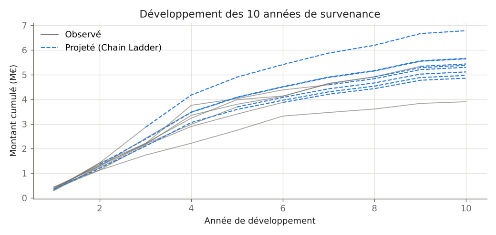
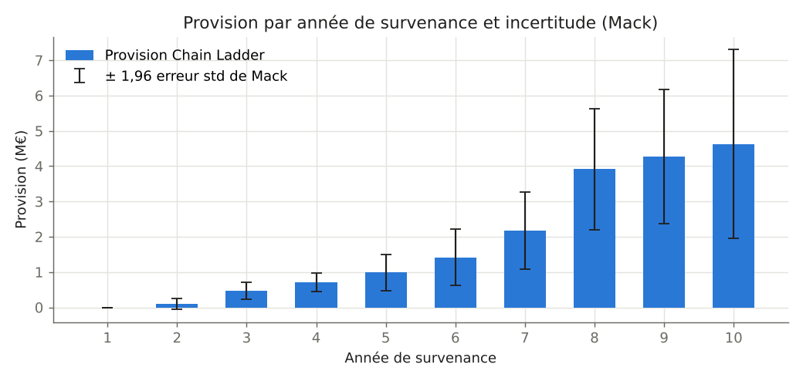
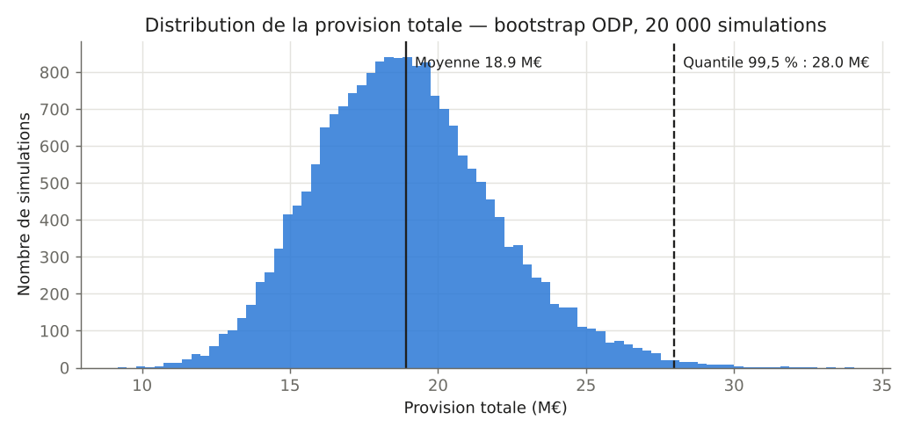
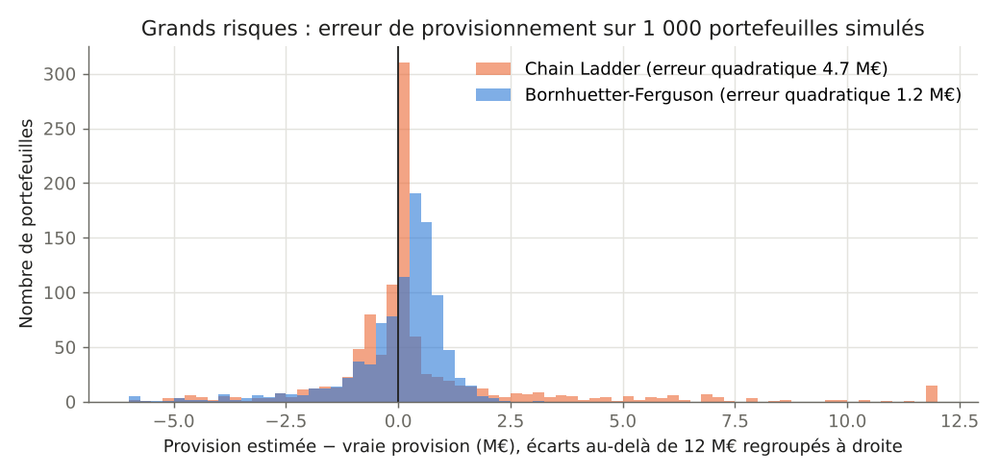

# Provisionnement IARD


Bibliothèque Python de **provisionnement non-vie** : estimation des provisions pour sinistres à payer (dont les IBNR) et mesure de leur incertitude.

| Méthode | Ce qu'elle donne |
|---|---|
| **Chain Ladder** | Provision « best estimate » à partir des facteurs de développement |
| **Bornhuetter-Ferguson** | Provision qui combine l'observé et une charge a priori (prime × S/P attendu) |
| **Sinistres espérés** | Charge ultime = prime × S/P attendu, utile quand l'historique est trop pauvre |
| **Mack (1993)** | Erreur standard de la provision Chain Ladder, par année et au total |
| **Bootstrap ODP** (England & Verrall) | Distribution complète de la provision, quantile à 99,5 % |

Le projet contient aussi une étude sur un cas plus difficile : les **portefeuilles de grands risques**, typiques d'une captive ou d'un réassureur.

## Résultats sur un triangle de référence

Le triangle de Taylor & Ashe (1983) est le jeu de données utilisé par Mack et par England & Verrall. Les résultats reproduisent exactement les valeurs publiées : la provision totale est de **18 680 856** et l'erreur standard de Mack de **2 447 095**. Ces valeurs sont vérifiées par les tests.

| Survenance | Provision | Erreur std (Mack) | CV |
|---:|---:|---:|---:|
| 2 | 94 634 | 75 535 | 79,8 % |
| 3 | 469 511 | 121 699 | 25,9 % |
| 4 | 709 638 | 133 549 | 18,8 % |
| 5 | 984 889 | 261 406 | 26,5 % |
| 6 | 1 419 459 | 411 010 | 29,0 % |
| 7 | 2 177 641 | 558 317 | 25,6 % |
| 8 | 3 920 301 | 875 328 | 22,3 % |
| 9 | 4 278 972 | 971 258 | 22,7 % |
| 10 | 4 625 811 | 1 363 155 | 29,5 % |
| **Total** | **18 680 856** | **2 447 095** | **13,1 %** |





Les années récentes portent l'essentiel de la provision **et** de l'incertitude : l'année 10 n'a qu'un an d'historique.

### Distribution de la provision : bootstrap ODP

Le bootstrap rééchantillonne les résidus de Pearson du modèle de Poisson surdispersé. Il réestime le Chain Ladder sur chaque pseudo-triangle (risque d'estimation), puis simule les paiements futurs selon une loi Gamma (risque de processus).

| 20 000 simulations | Montant |
|---|---:|
| Provision moyenne | 18,9 M |
| Erreur standard | 3,05 M (CV 16 %) |
| Quantile 95 % | 24,3 M |
| **Quantile 99,5 %** | **28,0 M** |



Le coefficient de variation de 16 % est cohérent avec celui publié par England & Verrall pour ce triangle. Il est plus élevé que celui de Mack (13 %), car le modèle ODP fait des hypothèses de variance différentes. Le quantile à 99,5 % est le niveau de confiance retenu par Solvabilité II.

## Étude : provisionner des grands risques

Sur un portefeuille de grands risques (dommages industriels, responsabilité civile, réassurance), les sinistres sont **rares mais coûteux**, et la garantie est plafonnée par sinistre. Le triangle contient alors beaucoup d'années blanches, et une année peut passer de zéro au plafond en un an. Le Chain Ladder applique mécaniquement des facteurs estimés sur très peu de sinistres et devient instable.

Pour le vérifier, `scripts/backtest_large_risks.py` simule **1 000 portefeuilles fictifs** sur 18 ans, avec les caractéristiques suivantes :
- en moyenne 0,35 sinistre par an ;
- un coût de loi de Pareto au-delà de 0,5 M€, plafonné à 5 M€ par sinistre ;
- des délais de déclaration ;
- une montée en charge progressive des provisions dossier.

La vraie provision est connue, ce qui permet de mesurer l'erreur de chaque méthode.

| Méthode | Biais moyen | Erreur quadratique | Intervalle 5–95 % |
|---|---:|---:|---:|
| Chain Ladder | +715 k€ | 4 724 k€ | −2,2 à +5,9 M€ |
| Bornhuetter-Ferguson | +16 k€ | **1 166 k€** | −2,3 à +1,2 M€ |



**Bornhuetter-Ferguson divise l'erreur par quatre.** Sur une année peu développée, la provision BF repose surtout sur la charge a priori (prime × S/P). L'observé prend le relais à mesure que l'année mûrit. Le Chain Ladder, au contraire, multiplie le premier sinistre déclaré par un facteur de développement élevé. Il surestime fortement quand un gros sinistre arrive tôt, et ne provisionne rien pour une année encore blanche.

Le module `large_risks` fournit aussi :
- la **méthode des sinistres espérés** ;
- un **retraitement « as if »** (`as_if_limit`), qui recalcule l'historique comme si la limite actuelle avait toujours été en vigueur. Les années deviennent ainsi comparables quand la structure du programme a changé.

## Démarrage rapide

```bash
pip install -r requirements.txt
python examples/demo.py                    # triangle de référence : CL, Mack, BF, bootstrap
python scripts/backtest_large_risks.py     # étude grands risques
pytest -q                                  # 16 tests
```

```python
from reserving import load_genins, MackChainLadder, ODPBootstrap

tri = load_genins()
mack = MackChainLadder().fit(tri).result()
mack.summary()                     # provision, erreur standard et CV par année

boot = ODPBootstrap(n_sims=20_000).fit(tri).result()
boot.quantile(0.995)               # quantile à 99,5 % de la provision totale
```

Le module `simulate` génère aussi un portefeuille automobile fictif de 10 000 sinistres, paiement par paiement. `Triangle.from_claims` construit directement le triangle à partir de ces données détaillées.

## Méthodologie

**Chain Ladder.** Facteurs pondérés par les volumes :
$$\hat f_k = \frac{\sum_i C_{i,k+1}}{\sum_i C_{i,k}}, \qquad \hat C_{i,n} = C_{i,n-i} \prod_{k \ge n-i} \hat f_k$$

**Bornhuetter-Ferguson.** Avec $P_i$ la prime et $\text{ELR}$ le S/P attendu :
$$\hat C_{i,n} = C_{i,n-i} + \left(1 - \frac{1}{\text{CDF}_{n-i}}\right) P_i \cdot \text{ELR}$$

**Mack.** Sous les hypothèses d'indépendance des années, $E[C_{i,k+1} \mid C_{i,k}] = f_k C_{i,k}$ et $\text{Var}[C_{i,k+1} \mid C_{i,k}] = \sigma_k^2 C_{i,k}$ :
$$\widehat{\text{msep}}(\hat R_i) = \hat C_{i,n}^2 \sum_{k=n-i}^{n-1} \frac{\hat\sigma_k^2}{\hat f_k^2}\left(\frac{1}{\hat C_{i,k}} + \frac{1}{\sum_{j \le n-k} C_{j,k}}\right)$$

L'erreur de la provision totale ajoute les covariances induites par les facteurs communs à toutes les années.

**Bootstrap ODP.** Résidus de Pearson $r_{i,k} = (X_{i,k} - m_{i,k}) / \sqrt{m_{i,k}}$. Paramètre d'échelle $\phi = \sum r^2 / (N - p)$, avec $N = 55$ observations et $p = 19$ paramètres. Correction de degrés de liberté $\sqrt{N/(N-p)}$. Risque de processus selon une loi Gamma de moyenne $m$ et de variance $\phi\, m$.

## Structure

```text
reserving-iard/
├── src/reserving/
│   ├── triangle.py      # triangle cumulé / incrémental, construction depuis les sinistres
│   ├── methods.py       # Chain Ladder, Bornhuetter-Ferguson
│   ├── mack.py          # modèle de Mack
│   ├── bootstrap.py     # bootstrap ODP
│   ├── large_risks.py   # grands risques : simulation, as if, sinistres espérés
│   ├── simulate.py      # portefeuille automobile fictif
│   └── datasets.py      # triangle de Taylor & Ashe
├── tests/               # 16 tests, dont les valeurs publiées de Mack
├── examples/demo.py
└── scripts/             # backtest grands risques, figures
```

## Références

- T. Mack, « Distribution-free calculation of the standard error of chain ladder reserve estimates », *ASTIN Bulletin*, 1993.
- P. England, R. Verrall, « Analytic and bootstrap estimates of prediction errors in claims reserving », *Insurance: Mathematics and Economics*, 1999.
- P. England, R. Verrall, « Stochastic claims reserving in general insurance », *British Actuarial Journal*, 2002.
- R. Bornhuetter, R. Ferguson, « The actuary and IBNR », *Proceedings of the CAS*, 1972.
- G. Taylor, F. Ashe, « Second moments of estimates of outstanding claims », *Journal of Econometrics*, 1983.

Toutes les données sont publiques (Taylor & Ashe) ou simulées.

## Auteur

**Mohammed Bahri** – Master Ingénierie Statistique et Informatique de la Finance, de l'Assurance et du Risque, Université Paris Cité
[LinkedIn](https://www.linkedin.com/in/mohammed-bahri/) · [GitHub](https://github.com/mohammedbahri1)
